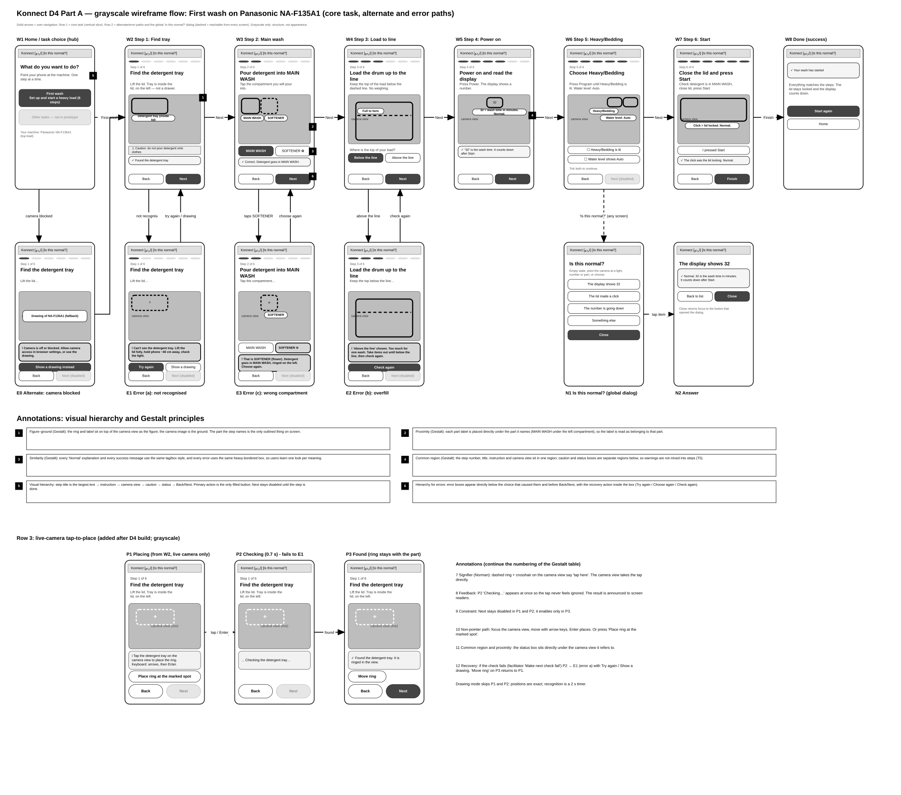

# 2. Wireframes

Grayscale, connected, with an alternate path and error paths. Source: [../Konnect_D4_PartA_Wireframes.drawio](../Konnect_D4_PartA_Wireframes.drawio) (open at app.diagrams.net). A static export is in [wireframes.svg](wireframes.svg) (open it in a browser; zoom in).

> The SVG export is a simplified rendering (straight arrows, approximate text wrapping). The .drawio file is the master.

## Screen inventory

| ID | Screen | Purpose | HTA | Req. | Evidence |
|---|---|---|---|---|---|
| W1 | Home / task choice (hub) | Choose "First wash" | 1 | R2 | H-15, J-08 |
| W2 | Step 1: Find the detergent tray | Ring the tray inside the lid | 3.1 | R1 | G-07, H-17 |
| W3 | Step 2: MAIN WASH | Choose the compartment, words under each | 3.2 | R1, R3 | F-08, H-12 |
| W4 | Step 3: Load to line | "Full to here" line; below / above | 4.1 | R3 | H-05, F-04 |
| W5 | Step 4: Power on, "32" | Explain the display number inline | 5.1 | R4 | F-03, H-08 |
| W6 | Step 5: Heavy/Bedding + water Auto | Confirm the program | 5.2 | R1 | H-10, G-10 |
| W7 | Step 6: Start, lid click | Press Start, interpret the click | 6.1, 6.2 | R3, R4 | F-07, H-14 |
| W8 | Done | Success state | | | |
| E0 | Camera blocked → drawing | Alternate path | | R5 | D3 risk 3 |
| E1 | Error (a): part not recognised | Specific, actionable recovery | | R1 | J-02 |
| E3 | Error (c): detergent in softener | Wrong compartment | | R3 | H-12 |
| E2 | Error (b): overfill | Above the line | | R3 | F-04 |
| N1, N2 | "Is this normal?" list and answer | Global, from any screen | 6.2 | R4 | H-14, F-03 |
| P1 | Placing: tap the part (live camera) | **New:** user puts the ring on the real part | | R1 | D3 risk 3 |
| P2 | Checking (mock recognition, 0.7 s) | **New:** immediate feedback | | R4 | |
| P3 | Found: ring stays with the part | **New:** ring placed; "Move ring" | | R1 | |

## Paths

| Path | Route |
|---|---|
| Core | W1 → W2 → W3 → W4 → W5 → W6 → W7 → W8 |
| Alternate: camera blocked | W1 → E0 → W2 (drawing mode) |
| Error (a): part not recognised | W2 ⇄ E1 (Try again, or Show a drawing instead) |
| Error (c): softener | W3 ⇄ E3 (Choose again) |
| Error (b): overfill | W4 ⇄ E2 (Check again) |
| Global | Any screen → N1 → N2 → back to the same screen |
| Live camera placement (new) | W2 → P1 → P2 → P3; P2 → E1 if the check fails; P3 → P1 via "Move ring" |

In drawing mode P1 and P2 are skipped: positions are exact and recognition is a 2 s timer.

## Visual hierarchy and Gestalt principles (explicit)

| # | Principle | Where |
|---|---|---|
| 1 | **Figure-ground** | The ring and label sit on top of the camera view; the camera is the ground, the named part is the only outlined thing |
| 2 | **Proximity** | Each part label sits directly under the part it names (e.g. MAIN WASH under its compartment) |
| 3 | **Similarity** | Every "Normal" explanation and every success message uses one style; every error uses one heavier-bordered style |
| 4 | **Common region** | The step frame (number, title, instruction, camera) is one region; caution and status are separate boxes |
| 5 | **Visual hierarchy** | Title (largest) → instruction → camera → caution → status → Back / Next. Only the primary action is filled |
| 6 | **Error hierarchy** | The error box sits directly under the choice that caused it; its recovery actions are inside it |
| 7 | **Signifier** (Norman) | Dashed ring and crosshair on the camera view say "tap here" (P1) |
| 8 | **Feedback** (Norman) | "Checking…" appears at once after a tap (P2) |
| 9 | **Constraint** (Norman) | Next stays disabled in P1 and P2 and enables in P3 |
| 10 | **Non-pointer path** | Focus the camera view, arrow keys, Enter; or the "Place ring at the marked spot" button |

## AI disclosure for wireframes

- The wireframe geometry was **generated by Claude** from the task flow (earlier session) and the new P1 to P3 screens were **added by Claude** as draw.io XML in this session. The SVG export is also script-generated.
- AI decisions: screen order from the HTA, error placement directly under the cause, recovery inside the error box, "Is this normal?" as a global dialog, Gestalt annotations.
- Team decisions: one appliance and one task, hub-and-spoke then sequential, three error paths, live camera with tap-to-place.
- The team should be able to explain every screen and the reason for each path.
